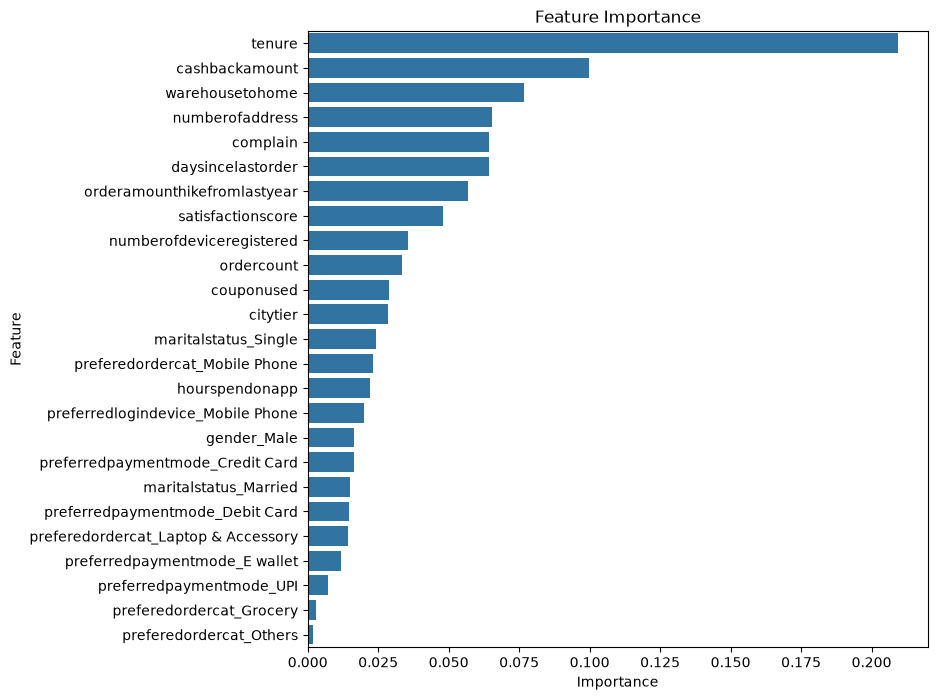
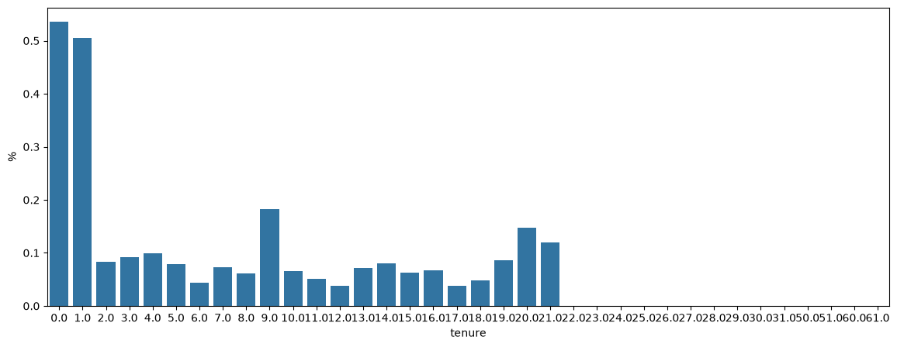
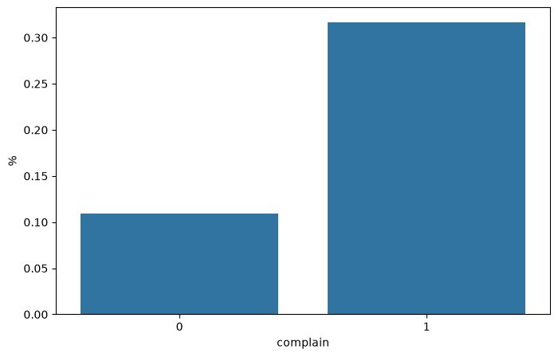
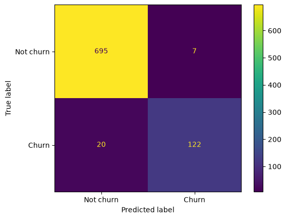
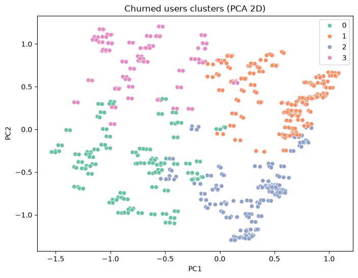

# 📊 Dự đoán và phân khúc khách hàng rời bỏ của một sàn thương mại điện tử | Python (Machine Learning)

[](https://colab.research.google.com/github/hoangvanhieu2004/Churn-Prediction-E-commerce-ML/blob/main/ML_final_project.ipynb)

_Tìm ra đặc điểm của khách hàng rời bỏ, dự đoán ai sắp rời bỏ và chia nhóm khách đã rời bỏ để thiết kế khuyến mãi giữ chân phù hợp._

- **Business question:** Khách hàng rời bỏ có hành vi gì? Có dự đoán trước được ai sẽ rời bỏ không? Nên đưa khuyến mãi gì cho từng nhóm khách đã rời bỏ?
- **Domain:** Thương mại điện tử (E-commerce), bài toán giữ chân khách hàng (customer retention)

Author: Hoàng Văn Hiếu
Date: 2026-11-04
Tools Used: Python (pandas, NumPy, scikit-learn, matplotlib, seaborn, missingno), Google Colab

---

## 📑 Table of Contents

1. [📌 Background & Overview](#-background--overview)
2. [📂 Dataset Description & Data Structure](#-dataset-description--data-structure)
3. [⚒️ Main Process](#️-main-process)
4. [🔎 Final Conclusion & Recommendations](#-final-conclusion--recommendations)

---

## 📌 Background & Overview

### 📖 What is this project about? What Business Question will it solve?

Một công ty thương mại điện tử đang mất **16,8%** khách hàng (948 trên 5.630 khách). Giữ một khách cũ thường rẻ hơn tìm khách mới, nên công ty cần biết ai sắp rời bỏ và nên giữ họ bằng cách nào. Dự án dùng Python để giải quyết 3 câu hỏi:

✔️ **EDA:** Khách hàng rời bỏ có hành vi gì? Công ty nên làm gì để giảm churn?
✔️ **Supervised Learning:** Xây mô hình dự đoán khách hàng sẽ rời bỏ để chăm sóc trước.
✔️ **Unsupervised Learning:** Chia khách đã rời bỏ thành nhóm (KMeans) để thiết kế khuyến mãi riêng cho từng nhóm.

### 👤 Who is this project for?

✔️ Đội Marketing và CRM: thiết kế chương trình giữ chân, khuyến mãi theo nhóm
✔️ Đội Chăm sóc khách hàng: ưu tiên liên hệ khách có nguy cơ rời bỏ cao
✔️ Data analyst / data scientist cần ví dụ trọn vẹn từ EDA tới mô hình và phân cụm

---

## 📂 Dataset Description & Data Structure

### 📌 Data Source

- **Source:** Dữ liệu khách hàng của một công ty thương mại điện tử, cung cấp cho bài tập ([`raws/churn_prediction.xlsx`](raws/churn_prediction.xlsx))
- **Size:** 5.630 dòng × 20 cột, mỗi dòng là một khách hàng; tỷ lệ churn 16,8% (948 khách)
- **Format:** .xlsx

### 📊 Data Structure & Relationships

#### 1️⃣ Tables Used

Dùng 1 bảng duy nhất, mỗi dòng là một khách hàng, cột `Churn` là nhãn cần dự đoán.

#### 2️⃣ Table Schema & Data Snapshot

<details>
<summary>Các cột chính (bấm để mở)</summary>

| Column Name | Data Type | Description |
|---|---|---|
| `CustomerID` | INT | Mã khách hàng (bỏ khi huấn luyện) |
| `Churn` | INT | Nhãn rời bỏ (1 = rời bỏ) |
| `Tenure` | FLOAT | Thời gian gắn bó với công ty |
| `PreferredLoginDevice` | TEXT | Thiết bị đăng nhập ưa thích |
| `CityTier` | INT | Phân hạng thành phố (1, 2, 3) |
| `WarehouseToHome` | FLOAT | Khoảng cách từ kho đến nhà khách hàng |
| `PreferredPaymentMode` | TEXT | Phương thức thanh toán ưa thích |
| `Gender`, `MaritalStatus` | TEXT | Giới tính, tình trạng hôn nhân |
| `HourSpendOnApp` | FLOAT | Số giờ sử dụng app/website |
| `NumberOfDeviceRegistered` | INT | Số thiết bị đã đăng ký |
| `PreferedOrderCat` | TEXT | Danh mục mua nhiều nhất tháng trước |
| `SatisfactionScore` | INT | Điểm hài lòng về dịch vụ |
| `NumberOfAddress` | INT | Số địa chỉ đã thêm |
| `Complain` | INT | Có khiếu nại trong tháng trước hay không |
| `OrderAmountHikeFromlastYear` | FLOAT | % tăng giá trị đơn so với năm trước |
| `CouponUsed`, `OrderCount` | FLOAT | Số coupon đã dùng, số đơn tháng trước |
| `DaySinceLastOrder` | FLOAT | Số ngày từ đơn gần nhất |
| `CashbackAmount` | FLOAT | Cashback trung bình tháng trước |

</details>

---

## ⚒️ Main Process

1️⃣ Data Cleaning & Preprocessing → 2️⃣ Exploratory Data Analysis → 3️⃣ Python Analysis (mô hình dự đoán và phân cụm)

### Task 1: Làm sạch và tiền xử lý dữ liệu

Mô hình không chạy được với ô trống, và cùng một ý nghĩa mà ghi nhiều kiểu (`COD` và `Cash on Delivery`) sẽ bị hiểu thành hai nhóm khác nhau. Các bước làm sạch:

- **Giá trị thiếu (~4–5% ở 7 cột):** điền median cho `tenure`, `warehousetohome`, `orderamounthikefromlastyear`, `ordercount`, `daysincelastorder`; điền 0 cho `hourspendonapp`, `couponused` (thiếu nghĩa là không dùng).
- **Chuẩn hoá giá trị cùng nghĩa:** `Phone` → `Mobile Phone`, `COD` → `Cash on Delivery`, `CC` → `Credit Card`, `Mobile` → `Mobile Phone`.
- **Mã hoá:** one-hot encoding cho 5 biến phân loại.

```python
def replace_func(list_column):
    for i in list_column:
        if i in ['tenure', 'warehousetohome', 'orderamounthikefromlastyear', 'ordercount', 'daysincelastorder']:
            df[i] = df[i].fillna(df[i].median())
        else:
            df[i] = df[i].fillna(0)

replace_func(list_null)
```

---

### Task 2: Khách hàng rời bỏ có hành vi gì? (EDA)

Để không phải xem hết 19 biến, mình chạy nhanh một Random Forest và dùng **feature importance** để chọn ra các biến liên quan nhiều nhất tới churn, rồi mới vẽ biểu đồ phân tích sâu từng biến.



Các biến quan trọng nhất: `tenure`, `cashbackamount`, `warehousetohome`, `numberofaddress`, `complain`, `daysincelastorder`.

| Tỷ lệ churn theo thời gian gắn bó (tenure) | Tỷ lệ churn theo khiếu nại |
|---|---|
|  |  |

**Observation:**
- **Khách mới rời bỏ nhiều nhất:** khách có tenure 0–1 có tỷ lệ churn trên 50%, sau đó giảm mạnh xuống khoảng 5–10%.
- **Khách rời bỏ nhận ít cashback hơn** khách ở lại.
- **Khách có khiếu nại rời bỏ nhiều hơn rõ rệt** so với khách không khiếu nại.
- `warehousetohome` có phân phối gần như giống nhau ở hai nhóm, nên được loại khỏi mô hình; các khách có `numberofaddress` bất thường (19–22) cũng bị loại.

---

### Task 3: Mô hình dự đoán khách hàng rời bỏ

Dữ liệu mất cân bằng (chỉ 16,8% churn), nên mô hình được chấm bằng **balanced accuracy**: trung bình recall của hai lớp. Nhờ vậy một mô hình đoán "không ai rời bỏ" sẽ không đạt điểm cao. Dữ liệu chia Train/Validation/Test = 70/15/15 theo phân tầng (stratified) để giữ tỷ lệ churn ở mỗi tập.

```python
x_train, x_temp, y_train, y_temp = train_test_split(x, y, test_size=0.3, random_state=42, stratify=y)
x_val, x_test, y_val, y_test = train_test_split(x_temp, y_temp, test_size=0.5, random_state=42, stratify=y_temp)
```

So sánh 4 mô hình trên tập validation:

| Mô hình | Precision | Recall | Balanced accuracy |
|---|---:|---:|---:|
| **Random Forest** | 0.95 | 0.82 | **0.91** |
| Gradient Boosting | 0.81 | 0.64 | 0.81 |
| Decision Tree | 0.67 | 0.59 | 0.77 |
| Logistic Regression | 0.73 | 0.56 | 0.76 |

Random Forest tốt nhất nên được tinh chỉnh bằng `GridSearchCV` (5-fold). Tham số chọn được: `n_estimators=200, max_depth=30, bootstrap=False`.

| Tập | Balanced accuracy |
|---|---:|
| Train | 1.000 |
| Validation | 0.944 |
| **Test** | **0.925** |



**Observation:** Trên tập test, mô hình bắt được **122 trên 142 khách sẽ rời bỏ (recall 0.86)** và chỉ báo nhầm 7 khách (precision 0.95). Balanced accuracy trên tập train bằng 1.0 cho thấy mô hình có dấu hiệu overfitting; có thể cải thiện bằng cách giới hạn độ sâu cây hoặc tăng `min_samples_leaf`.

---

### Task 4: Phân khúc khách hàng đã rời bỏ (KMeans)

Không thể dùng một khuyến mãi cho mọi khách đã rời bỏ, vì lý do họ rời đi khác nhau. Mình lấy 948 khách có `churn = 1`, chuẩn hoá Min-Max, chọn K bằng Elbow và Silhouette, rồi chạy KMeans.



| Cụm | Đặc điểm | Đề xuất khuyến mãi |
|---|---|---|
| **0 – Khách lâu năm, giá trị cao** (~192 KH) | Tenure cao nhất, nhiều đơn, cashback cao, ít khiếu nại nhất, nhưng điểm hài lòng thấp nhất; mua Laptop & Accessory | Chương trình khách hàng thân thiết, ưu đãi Laptop & Accessory, khảo sát để cải thiện mức hài lòng |
| **1 – Khách mới, ít tương tác** (~346 KH) | Tenure thấp nhất, ít đơn, cashback thấp, mua Mobile Phone, City tier 1 | Ưu đãi onboarding, voucher cho đơn thứ 2–3, tăng cashback cho điện thoại |
| **2 – Khách mới hay khiếu nại** (~244 KH) | Tỷ lệ khiếu nại cao nhất (~69%), tenure thấp, ít đơn | Chủ động liên hệ xử lý khiếu nại, voucher bồi thường |
| **3 – Khách ở tỉnh xa** (~166 KH) | City tier 3, xa kho nhất, khiếu nại cao (~64%), điểm hài lòng cao nhất | Miễn hoặc giảm phí vận chuyển, giao nhanh hơn cho vùng xa |

**Observation:** Nhóm lớn nhất là **khách mới ít tương tác** (~346 khách, hơn 1/3 số khách rời bỏ). Silhouette score của mọi K chỉ khoảng 0.12–0.14, tức các cụm không tách biệt rõ, nên kết quả phân cụm chỉ mang tính tham khảo.

---

## 🔎 Final Conclusion & Recommendations

👉🏻 Dựa trên các phân tích trên, đề xuất **đội Marketing, CRM và Chăm sóc khách hàng** cân nhắc:

📍 Key Takeaways:
✔️ **Tập trung vào vài tháng đầu của khách mới:** tenure 0–1 có tỷ lệ churn trên 50%. Cần chương trình onboarding và voucher cho đơn thứ 2–3.
✔️ **Xử lý khiếu nại triệt để và dùng cashback làm đòn bẩy giữ chân:** khách khiếu nại và khách nhận ít cashback rời bỏ nhiều hơn rõ rệt.
✔️ **Đưa mô hình Random Forest vào vận hành** để chấm điểm rủi ro hằng tháng: mô hình bắt được 86% khách sắp rời bỏ với độ chính xác 95%, đủ để đội CSKH ưu tiên liên hệ.
✔️ **Khuyến mãi theo nhóm** thay vì đại trà: loyalty cho khách lâu năm, onboarding cho khách mới, bồi thường cho khách khiếu nại, giảm phí ship cho khách ở tỉnh xa.

<details>
<summary>Cách chạy và cấu trúc thư mục (bấm để mở)</summary>

**Google Colab (khuyến nghị):** bấm nút **Open In Colab** ở đầu trang, rồi chọn **Runtime → Run all**. Notebook tự tải `churn_prediction.xlsx` từ Google Drive vào thư mục `raws/`; các thư viện đều có sẵn trên Colab.

**Chạy local:**

```bash
git clone https://github.com/hoangvanhieu2004/Churn-Prediction-E-commerce-ML.git
cd Churn-Prediction-E-commerce-ML
pip install -r requirements.txt
jupyter notebook ML_final_project.ipynb
```

```text
.
├── raws/churn_prediction.xlsx   # Dữ liệu thô (5.630 khách hàng, 20 cột)
├── ML_final_project.ipynb       # Notebook chính: tiền xử lý, EDA, mô hình, phân cụm
├── images/                      # Biểu đồ trích từ notebook
├── requirements.txt
└── README.md
```

</details>
